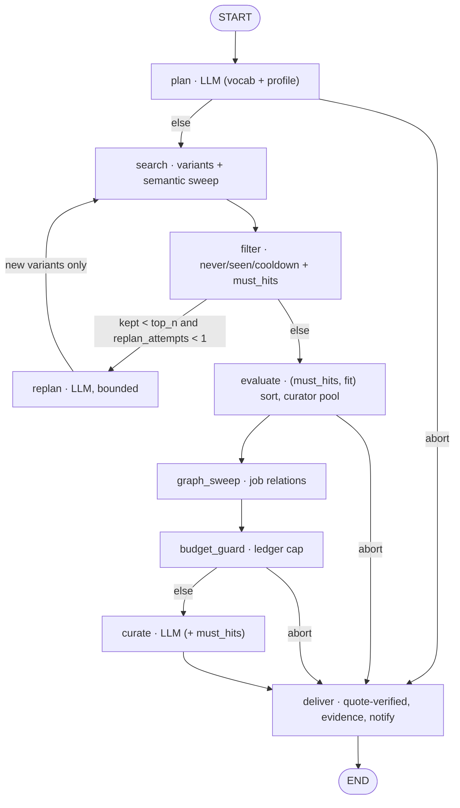
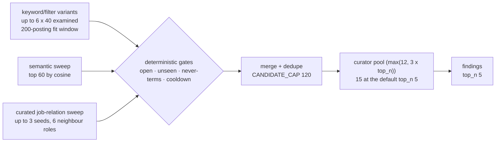
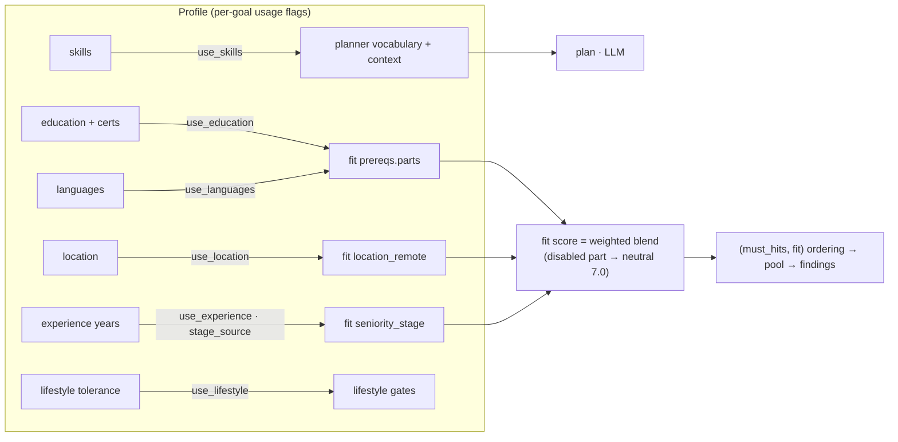
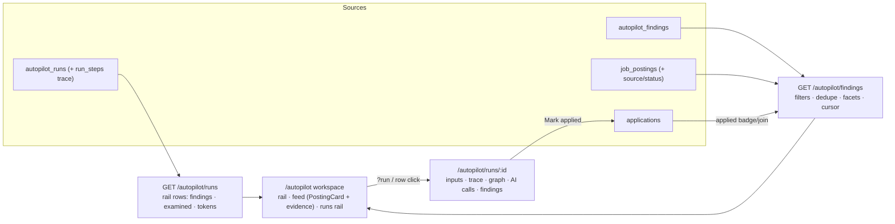
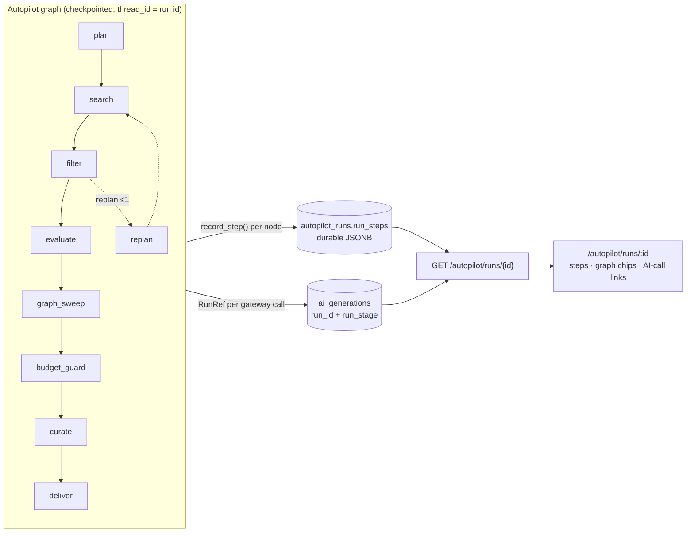
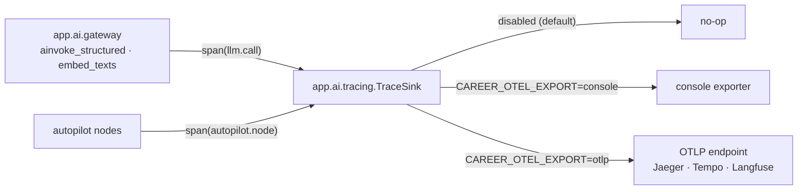
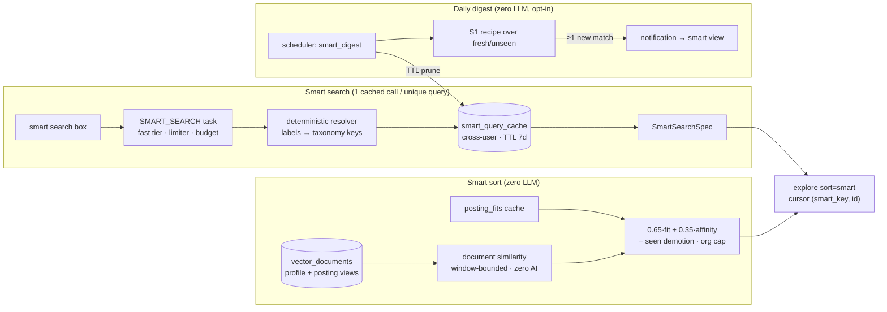
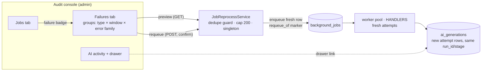

# AI layer

Everything AI in Career Assistant lives under `backend/app/ai/` and flows
through **one gateway**. There is no side door. The family-wide rules are in
the `family-ai` skill; this page is the app-specific map.

## The gateway is the only invocation path

- `app.ai.gateway.ainvoke_structured` — the single structured-output call.
  Resolves provider → model, calls the LangChain chat model, pydantic-validates
  the response, and writes an audit row to `ai_generations`.
- `gateway.ainvoke_agent` — the tool-calling path (used by the chat turn and
  the CV enrich step).
- `with_audit_ref` — an opt-in that returns the audit row just written without
  a second SELECT (used by run-linked flows).

**`app/ai/chat_models.py` is the only module that touches provider SDKs.**
`scripts/check-ai-alignment.sh` enforces this (ADR-0008/0018); the decision
SDK (`typesafe_sdk`) is sanctioned inside `app/ai/decide/` only
(ADR-0032).

## Configuration is data, not env

Providers, models and per-task assignments live exclusively in the database
(`ai_providers`, `ai_models`, `ai_task_assignments`) and are managed in
**Settings → AI Configuration**. There are deliberately **no `AI_*`**
environment variables. Production starts unconfigured — AI endpoints answer
`503` until an admin adds a provider.

### BYOK setup (§15, family contract)

One-click provider setup follows the frozen §15 contract: preset tiles →
guided form (fetch-first validation, nothing persists on a classified
failure) → defaults bound for the **capability slots** only. The
generated preset catalog (`app/ai/providers/presets_data.py`) is synced
byte-identical from the dev canonical (`contracts/ai-presets.json`,
`scripts/sync-ai-presets.mjs`) — never hand-edited; the byok contract gate
(`scripts/check-byok-contract.sh`, R1–R7 in CI) enforces the data, the
error enum and the decision-secret rules. Setup is **scope-aware**: rows
land at the caller's scope (user by default, system for admins) and never
cross.

### Capability slots and resolution order

The four §15 slots (`text` / `vision` / `stt` / `tts`) plus `embeddings`
(career's embed task needs its own slot — a recorded §15 delta) live as
plain assignments keyed on the capability. Resolution order: per-task
explicit binding (user > system) → per-task tier → the task's capability
slot (user > system) → slot tier. The legacy global `default` pseudo-task
is gone end-to-end. Capabilities are the §15 split vocabulary
(`text|vision|tools|stt|tts|embeddings|decision`) — `decision` is
explicit-only, never name-inferred.

The built-in **mock provider** is opt-in via the `CAREER_MOCK_AI=1` infra knob
(dev/test only). When it resolves, the gateway self-registers deterministic
fixtures (`ensure_mock_registry` in `gateway.py`; builders in
`mock_chat.py`). With the knob off, mock rows are invisible to task
resolution; production refuses mock results regardless.

## Tasks and capabilities

`app/ai/tasks.py` holds the task registry (`TaskDef`); the task vocabulary is
`AITaskType` in `app/models/enums.py`. A task declares the **capabilities** it
needs (`AICapability`: `text`, `vision`, `tools`, `embeddings`, `stt`,
`tts`, `decision`) and a tier (`AITaskTier`), and a model is only assigned
to tasks it can serve (slot separation is enforced both directions —
decision-capable models only satisfy the `decision_*` slots).

Representative tasks: `job_generate`, `relation_suggest`, `match_score`,
`university_parse`, `path_suggest`, `profile_analyze`, `posting_map`,
`posting_extract`, `target_resolve`, `chat`, `chat_ops`, `assist`,
`cv_draft`, `cv_synth`, `cv_parse`, `cv_build_review`, `cv_builder_chat`,
`cv_cover_letter`, `cv_template_design`, `interview_plan`/`interview_turn`/
`interview_debrief`, `assessment_generate`, `catalog_enrich`, `chat_title`,
`autopilot_run`, `embed`, `mcp_tool_call`, `transcribe`.

## Agents

One module per AI task under `app/ai/agents/` (for example `job_generator.py`,
`match_scorer.py`, `university_parser.py`, `posting_extractor.py`,
`cv_drafter.py`, `cv_build_reviewer.py`, `chatbot.py`, `interview_coach.py`).
An agent builds the prompt, calls the gateway and returns a validated shape.
Prompts are versioned (`app/ai/prompt_versions.py`).

## Flows are LangGraph graphs

Multi-step flows are checkpointed `StateGraph`s under `app/ai/graphs/`:

- `cv_draft.py` — the one-shot CV generation flow (plan → enrich → synthesize
  → assemble → review/fix).
- `autopilot.py` — the Autopilot run (the full reference below).
- `chat_turn.py` — the main chat turn: `retrieve` → `agent_round ⇄
  execute_tools` → `synth` → `hitl` → `finalize`.

The checkpointer is app-lifespan-owned (`app/ai/checkpointer.py`:
`AsyncPostgresSaver` web / `AsyncSqliteSaver` desktop) and `thread_id` is the
run id, so an interrupted run resumes from its last completed node via
`ainvoke(None, config)`. Retention: desktop prunes SQLite at boot
(`CAREER_CHECKPOINT_TTL_DAYS`); the server prunes Postgres on the daily
`system_checkpoint_prune` schedule.

### The Autopilot graph (reference flow)

Deterministic nodes do one thing each; the three audited LLM steps (`plan`,
`replan`, `curate`) are one gateway call apiece on the `AUTOPILOT_RUN` task.
The LLM proposes, math ranks: fit and must-term coverage are computed in
Python, and explanations ship only after quote verification.

**Topology** — one checkpoint per node boundary; the loop edge is bounded by
`REPLAN_LIMIT`:

**Candidate funnel** — three recall sources, every one of them behind the same
deterministic gates:

**Pinned constants** (the truth gate `backend/tests/test_autopilot_docs_truth.py`
compares this table with the code):

| Constant | Value | Meaning |
|---|---|---|
| `SEARCH_VARIANTS` | 6 | planned variants executed per pass |
| `SEARCH_LIMIT` | 40 | examined postings per variant |
| `SEMANTIC_K` | 60 | semantic candidates per run |
| `GRAPH_SEEDS` | 3 | mapped matches that seed the relation walk |
| `GRAPH_NEIGHBORS` | 6 | neighbour roles the walk may expand to |
| `CANDIDATE_CAP` | 120 | checkpointed merge pool ceiling |
| `CURATOR_POOL` | 15 | curated shortlist pool at the default top_n |
| `REPLAN_LIMIT` | 1 | broaden passes per run |

**State channels** — what is checkpointed, its bound, and why:

| Channel | Bound | Why it is in the checkpoint |
|---|---|---|
| `plan` | ≤ 6 variants | the plan is the run's contract; a resume re-executes it |
| `candidates` | `CANDIDATE_CAP` 120 | the merge pool rides every write — the cap bounds checkpoint weight (~1.5 KB each) on Postgres and SQLite alike |
| `searches` | one entry per search/filter/replan step | the transparency timeline the UI renders |
| `replan_attempts` / `replans` | 1 attempt | the loop edge's governor; resumable |
| `curation` | ≤ 10 findings | the LLM's shortlist explanation |
| `progress_pct` | 0-100, monotonic | the progress callback must never report backwards on a re-entry |
| `profile_context` | ≤ 12 skills | the planner's grounding; computed once per run |
| `abort_reason` / `tokens_used` | one value | routing + the run's recorded spend |
| `trace_steps` | one entry per executed node | the durable run trace — persisted to `autopilot_runs.run_steps` at deliver, survives checkpoint pruning |

**Similarity signals** — what each recall source catches, needs and how it
degrades:

| Source | Catches | Needs | Degrades by |
|---|---|---|---|
| Keyword/filter variants | exact vocabulary: titles, employers, skill keys, enums | nothing beyond the catalog | a bad variant is dropped with a timeline error; the rest still run |
| Semantic sweep (embeddings) | wording and description-level meaning no keyword shares | stored posting embeddings + an assigned `embed` task | timeline entry with a sanitized note; lexical candidates unaffected |
| Curated job-relation sweep | role adjacency (`similar_to`/`alternative_to`) no text encodes | postings mapped to catalog jobs + curated relations | no-op timeline entry; no embeddings, no AI, desktop-safe |

All three sources share one recall contract (ADR-0012 §13 addendum): a
candidate is only *proposed* — every one of them passes the same deterministic
gates in code before entering the pool, so a vector hit can never resurrect a
gated-out row; ordering stays deterministic (`(must_hits, fit)`) with cosine
absent from it; any embedding failure degrades to lexical-only. Semantic
candidates whose cosine is zero or negative carry no signal and are dropped
before gating (`_semantic_sweep`) — that cutoff decides recall only, never
rank.

**Budget and abort routing** — every `abort_reason`, where it fires, and what
still ships:

| `abort_reason` | Fires at | What still ships |
|---|---|---|
| `budget` | `plan` (gateway refuses), `budget_guard` (ledger cap over `ai_budgets`) | searched candidates ship with deterministic `Fit …` explanations (`budget_aborted`) |
| `cancelled` | `budget_guard` (user cancel) | the same partial path, status `cancelled` |
| `error` | `plan`/`curate` gateway failure with no findings | status `failed`; with findings the run completes |
| none (empty pool) | never aborts | an empty run counts toward the stale-goal nudge after 3 |

A replan spends one audited call; when the run budget is already spent the
node skips the call and the deterministic findings still ship.

### Profile usage & goal-adjusted fit (plan 169)

Every goal carries a `profile` block on its constraints (`ProfileUsage`:
six `use_*` toggles + `stage_source: "profile" | "goal"`, defaults
reproducing the pre-plan behavior). `AutopilotService.run_goal` derives a
`FitOverrides` from it once and threads it through `GraphDeps`; the
planner and the fit engine honor it:

- **Planner context** — `collect_profile_context` drops a disabled input
  (with everything off it plans from the goal text + vocabulary alone),
  adds the academic languages when `use_languages`, and shows the
  effective stage: `stage_source="goal"` derives it from the goal's
  seniority selection by max rank (intern→`student`,
  junior/mid→`early_career`, senior+→`experienced`; an empty selection
  keeps the profile stage), and `use_experience=False` omits it. The
  plan/replan vocabulary skips the user-skill neighbourhood when
  `use_skills` is off (frequency padding only).
- **Fit** — disabled dimensions score the engine's neutral 7.0 with a
  `disabled` marker (`use_lifestyle` empties the gates instead — gates
  are recomputed live, never cached); the `prereqs` dimension carries
  internal per-part sub-scores (`parts: {education, languages,
  certificates}`, each `{kind, cap, detail, scored}`) and merges like the
  pre-plan accumulator: any `scored` part makes the dimension
  non-neutral at the min over the enabled parts' `cap`s (a recognized
  education comparison caps without scoring — education-met/below alone
  stay the neutral 7.0, exactly the pre-plan gate), a disabled part is
  excluded from both the min and the scored-any check so the merged
  score can only rise or stay, and nothing scored reads 7.0 neutral.
  `stage_source="goal"` swaps the
  stage value into the pure `_seniority_stage_dimension`; a disabled
  `use_experience` wins over it.
- **Cache law** — `posting_fits` keeps ONE canonical row per
  user×posting; the usage flags never ride `inputs_hash` (toggle
  invariant). With active overrides the batch result is a **derived
  rescore** over the canonical breakdown (`_rescore_cached`: pure math +
  one pure stage recompute); a canonical miss computes and writes
  canonically first, then rescores — adjusted values are never persisted,
  and archetype-estimate rows are never rescored. The `explore` fit-sort
  window accepts the same overrides, so window selection honors the
  toggles; the non-fit-sort enrichment stays canonical, as do the posting
  detail card and the chat "my fit" tool.
- **Explanations** — `_deterministic_why` filters `disabled: True`
  dimensions out BEFORE slicing to three (fit-only line when none
  remain), and the curator system prompt forbids citing disabled
  dimensions as strengths or weaknesses (`AUTOPILOT_RUN` prompt v7).

### Findings feed and runs rail (plan 175)

The shortlist is the product surface. `GET /autopilot/findings` returns a
flat, keyset-paginated feed of findings joined with their postings; the
workspace (`/autopilot`) renders it with the same card primitives as
`/postings`, a filter rail, a runs rail and the run page
(`/autopilot/runs/:runId`).

- Filters, all server-side over the run → goal / posting joins:
  `goal_id`, `run_id`, `state` (`open|dismissed|all`, default open),
  `latest_per_posting` (default true — the posting's newest evaluation
  wins via a row-value `(created_at, id)` comparison, and the state
  filter applies to the surviving row), `sort` (`newest|score`),
  `limit`, `cursor`, `min_score`, `coverage_min` (must-coverage hits via
  a dialect-split JSONB path), `org` (ilike), `source`, `seniority`,
  `remote`, `posted_within` (the shared effective-posted `window_clause`)
  and `hide_applied`. Ownership rides the goal join — another user's
  rows are invisible. The applied badge derives from the caller's
  `applications` join, never a stored flag;
  `POST /autopilot/runs/{run_id}/dismiss-findings` bulk-dismisses one
  run's open findings (no constraint learning).
- Cursors are opaque `(sort_key, id)` keyset markers per sort — score
  ties are guaranteed (`score` is `Numeric(4,2)`), so a single-key
  cursor would loop. The keyset runs over the deduped row's own
  `(sort_key, id)`: a re-rank between pages (a newer evaluation
  displacing the cursor row) is accepted drift, never a loop or a
  repeat.
- Facets for `goal`, `source`, `seniority` and `state` ride the same
  response, self-excluding (each dimension recounts without its own
  filter, the explore pattern).
- `GET /autopilot/runs` is the runs rail — status, tokens, live
  findings and the Σ `examined` per run, cross-goal, newest first. The
  timeline itself stays on `GET /autopilot/runs/{run_id}` (plan 168).

### Run trace (plan 168)

Every executed node lands one entry in the `trace_steps` state channel —
append-return, exactly the `searches` precedent, so a retried node
contributes nothing on its failed attempt and a resume never duplicates an
entry (`iteration` distinguishes the legitimate second `search`/`filter`
pass after a replan). `deliver` persists the accumulated list to
`autopilot_runs.run_steps`; a run that dies mid-graph persists the steps up
to the last completed node plus a `failed` status via the service's failure
path. **The trace is a ledger, not checkpoint history**: checkpoints are
TTL-pruned (desktop boot prune, server `system_checkpoint_prune`), the
trace survives restarts and prunes and dies only with the goal (the run
cascade) — `ai_generations` rows outlive it by design.

Each entry carries `{step, kind, iteration, at, duration_ms, args, output,
error, abort}` where `args`/`output` are **whitelisted summaries** — the
plan step's goal text clipped to 400 chars, constraint/budget keys and the
profile-context shape; search variant queries/filters with found/examined;
filter kept/dropped counts; evaluate pool/fit-range/must-hits histogram;
graph-sweep seeds and merge counts; guard tokens-vs-caps and the abort
reason; curate picks; deliver findings (ids/scores), status and whether the
notification fired. Candidate ids stay capped at 120 (`CANDIDATE_CAP`) and
no entry carries a serialized candidate — prompts and full outputs remain
admin-only in the audit ledger.

The owner-facing surface is `GET /autopilot/runs/{run_id}` (owner-scoped
product detail, a foreign and a missing run answer the same 404): `{run,
steps, nodes, ai_calls, findings, timeline, trace_available}` — `ai_calls`
joins `ai_generations` by `run_id` with metadata only (no
prompt/output text), and `trace_available` is false for pre-0079 runs
(steps `[]` — the UI falls back to the timeline). `nodes` is the
**execution-ordered** node list derived from the compiled graph —
`plan`, `search`, `filter`, `replan`, `evaluate`, `graph_sweep`,
`budget_guard`, `curate`, `deliver` (compiled insertion order is not
execution order; `budget_guard` is added second but runs late). Runs
beyond the 30-row listings resolve by id. The UI renders the payload as
the `?run=<id>` detail modal on `/autopilot`.

### Tracing export (plan 168)

The first-party trace above is the product surface; OpenTelemetry is an
**optional export adapter, never a second surface** (ADR-0044 addendum).
`app/ai/tracing.py` exposes one `TraceSink`: `autopilot.run` (root, in
`AutopilotService.run_goal` — the single entry for API, queue and chat
callers), `autopilot.node` (one per graph node, started by the wiring
wrapper around each node callable — `deliver` included — so retries and
replan re-entries start fresh) and `llm.call` (in `ainvoke_structured`
and `embed_texts`). Every span carries `run_id` + `goal_id` (a contextvar
scope stamps nested spans, so a lost asyncio context stays correlatable)
plus the metadata vocabulary — `node`, `task_type`, `provider`, `model`,
`tokens_in/out`, `latency_ms`, `status`, `prompt_version` — and **never**
prompt or output text. Destinations: any OTLP backend (Jaeger, Tempo,
Grafana, Langfuse over OTLP). Infra knobs only, like `CAREER_MOCK_AI` —
never AI config: `CAREER_OTEL_EXPORT` (`""` default | `console` | `otlp`),
`CAREER_OTEL_ENDPOINT` (required for otlp), `CAREER_OTEL_SERVICE_NAME`
(default `career-assistant`). Without the `otel` extra installed the
guarded import keeps every span a no-op — desktop stays zero-setup and
inert. A bad value or a missing endpoint disables the sink with exactly
one warning; a sink failure never fails the wrapped call. Enabling builds
the sink its **own** `TracerProvider` with the env-selected exporter behind
a `BatchSpanProcessor` (buffered background export), and the tracer is
taken from that same provider — the global OTel provider is never touched,
so an unconfigured process stays a no-op `ProxyTracerProvider`. App-lifespan
shutdown calls `sink.shutdown()`, which flushes pending spans and releases
the provider (`sink.flush()` is available for bounded force-export before
long-lived phases).

## Decision models (`app/ai/decide/`)

Non-chat decision points (tool dispatch, gates, choice, score) resolve
through the decision funnel — the family transport model (ADR-0019/0020 +
ADR-0032): no engine enum, a model row carries `decision_transport`
(`systemone` today) and the registry routes `decision:<cap>` slot →
assignment row (the caller's own first, system second — the scope chain is
the fallback chain) → model → provider. `off` is a resolution result;
unassigned or failing slots fall through (fail-open), never raise.

- `app/ai/decide/types.py` — the slot family, the D2b sparse capability
  matrix (transport-declared: `systemone` serves tool-dispatch,
  boolean-gate, choice, score; `open-args` is vocabulary-only), question /
  answer / outcome shapes.
- `app/ai/decide/registry.py` — one registration per transport
  (`resolve/create/audit/probe`); resolution cached per a stateless
  assignments-revision fingerprint.
- `app/ai/decide/funnel.py` — `run_decision`: the one entry point. Exactly
  one `ai_generations` audit row per invocation (ok or failed, tokens +
  latency + wire model); bounded-confidence band (act / confirm / refuse).
- `app/ai/decide/systemone/` — the `typesafe_sdk` adapter (AI-layer
  confined; alignment gate R1), the projection, and the D13 decision
  probe (one typed question under the abort timeout — decision-only
  providers validate through it, never a chat completion).

Decision **setup** (provider, model, slot assignment) lives in Settings →
API settings like every other model — the tasks tab leads with the
Decision group; there is no separate decision-setup surface.

**Rule: don't graph-ify single-call tasks.** Flows whose every turn is one
gateway call stay as bounded structured turns (the CV builder copilot and the
interview practice loop ride the standard chat turn with a
`context.surface` branch).

## Tools

`app/ai/tools/` is a registry of `AITool` data with a single `run_tool`
executor. Tools declare an **audience** (`chat`, `cv_builder`, `mcp`) and a
**scope** (`read` / `write`). Plugins arrive via the entry-point group
`career_assistant.tools`, gated by `TOOL_PLUGINS_ALLOWLIST`.

- Read-scope tools surface over MCP.
- Write-scope tools (CV builder ops, profile proposals) execute through the
  same audited service functions the REST forms use.

## Skill packs

Versioned instruction data in `ai_skill_packs` (immutable versions; bank seeds
in `app/seeds/skill_packs.py`). `app/ai/packs.py` resolves the latest
published bank pack per task; the gateway appends it to the system prompt and
pins `pack_key`/`pack_version` on every `ai_generations` row. Packs steer
**tone and structure only** — validators are untouched.

## Vector retrieval

Embeddings still flow through the `embed` task (EMBEDDINGS capability), but
they land in the **family vector store** (plan 50, ADR-0051):
`vector_spaces` / `vector_documents` / `vector_records`
(`app/models/vector_model.py`) plus a per-space physical index — pgvector +
HNSW on PostgreSQL, `sqlite-vec` `vec0` on desktop, and a capped exact-linear
scan when neither extension loads. The retired `ai_embeddings` JSONB store is
gone (migration `0088`); one text is embedded once per changed view/chunk and
never re-embedded unchanged (content-hash dedupe).

- **Write path.** Versioned pure composers (`app/services/vector_composers.py`)
  turn a posting, catalog job, skill or profile into named views; the
  `VECTOR_INDEX` job indexes one document and the `VECTOR_RECONCILE` job
  backfills/reconciles the store in bounded keyset batches (resumable cursor,
  budget-capped, coverage snapshots only when a kind's chain completes). Both
  write through `app/storage/vector_store.py`, never dialect SQL.
- **Read path.** `app/services/vector_retrieval_service.py` embeds the query
  once, searches each view under the caller's opaque scope, aggregates chunks
  into a document score and fuses lexical rankings with weighted RRF
  (`app/services/hybrid_search.py` keeps the RRF math). Explore's relevance
  sort, the smart-sort affinity and the autopilot semantic sweep ride it.
  `match_documents` is the long-text read: a stored document's views against
  another kind on pinned view pairs (requirements/responsibilities lead, the
  chunked body is the fallback) with a bounded MaxSim over capped query
  chunks and a capped candidate set — no provider call, no corpus comparison.
  `match_text` is the same cascade fed by one query embedding, used by the
  job-detail reads when the job itself has no indexed document yet.
- **Degradation.** No provider, a failed embed, a missing space/index, a
  dimension mismatch or an over-cap scan each return the contract's structured
  reason and the caller falls back to the lexical/neutral path — **semantic is
  a ranking signal, never a filter gate**, and never a 500.

## The hybrid catalog mapping (plan 185)

The ingest decision is the **deterministic weighted skill overlap** over the
posting's resolved skills (`_best_catalog_job` ≥ `AUTO_MAP_THRESHOLD` 0.34),
evaluated at BOTH decision points (ingest sync and after the deep extract —
the extract's join is `decide_catalog`'s second caller, and `decide_catalog`
never touches `PostingSkill` rows). The method + `retag` journal make every
map auditable and admin-overridable (manual map endpoint,
`POST /admin/postings/{id}/remap` re-runs the join without the extract).

The **bounded semantic rerank** runs first where the deterministic outcome
is ambiguous — best below `AUTO_MAP_THRESHOLD` or a runner-up margin under
`δ = 0.08` (plan 164 S4.4, `app/services/postings/semantic_rerank.py`). It
scores **only the stage-2 candidates** the deterministic scorer produced
(`K = 25`), using the same stored-vector job↔posting match, and applies the
pinned blend `0.75·deterministic + 0.25·semantic`. A rerank is accepted only
when its top candidate clears `τ_job = 0.34` with the `δ` margin (and, when
the deterministic winner already cleared `τ_job`, only if the top-1 changes);
it records `semantic_rerank`, never silently replaces the deterministic
score, and never introduces a candidate. The plan-185 rescue below still
handles the below-threshold case the rerank could not lift.

The **semantic rescue** fires only where that overlap misses (plan 50 P2,
`app/services/postings/semantic_rescue.py`): the posting is indexed through
the sanctioned synchronous writer (unchanged content costs zero embeds; the
space must already exist — a fresh install records `index_missing` until the
index/reconcile job provisions it, because no ingest request ever issues
DDL), its stored views are matched against the `job` documents, and a
candidate may map
only when it clears `SEMANTIC_MAP_THRESHOLD` **and** shares ≥1 resolved skill
with the posting — the same deterministic evidence the overlap uses. Draft
jobs are filtered when candidates are hydrated, so they are never proposed.
The trace lands in `posting_facts["mapping_signals"]`:
`overlap {score, runner_up}` plus
`semantic {top, threshold, candidates[{code, score, shared_skills, per_view}],
space_key, degraded}` and `rerank {ran, top, accepted, margin, space_key,
candidates[...]}`. Any embedding/index failure degrades to the
overlap-only verdict and the reason is recorded — a posting write never fails
for it.

Every automatic decision also writes the bounded, versioned
`job_postings.mapping_features` payload (`mapping_version = 2`): the top
candidates with their deterministic/semantic/blend scores, shared taxonomy
keys and per-view scores, the pinned policy thresholds, the embedding
`space_key` and the degradation reason. A space cutover therefore has a
recorded dependency: `app/services/postings/mapping_remap.py` enqueues one
bounded `POSTING_REMAP` sweep over rows whose method is
`semantic`/`semantic_rerank` (never `manual`); plan 51's retirement action
calls `invalidate_mapping_space(space_key=retired.key)` after the new space
is active. The sweep re-runs `decide_catalog` only — it never rewrites
`PostingSkill` rows and never alerts.

Every embedding failure (unconfigured provider, gateway error, dim
mismatch) degrades to the overlap-only decision — the RRF discipline
recorded in the `retag` journal row's operation payload (the audit Changes
drawer renders it verbatim — that IS the join's trace; there is no LangGraph
here to stream). The `catalog.job_proposals` and `catalog.semantic_rescue`
run switches in `app_settings` are read per decision — effective on the next
decision, no restart.

A posting the overlap cannot place AND whose extract is rich enough (kept
title + ≥ 3 kept skills) stores `posting_facts["job_proposal"]` — the HITL
queue on the Taxonomy settings page; applying it creates the PUBLISHED
catalog job + maps MANUAL in one transaction
(`docs/dev/scheduler-and-jobs.md` carries the flow).

## Smart discovery (plan 179)

Cost-tiered by design — LLM appears exactly once in the whole feature:

| Component | LLM cost | When AI runs |
|---|---|---|
| `sort=smart` on /postings | **zero** | never — the profile document is embedded by the vector index/reconcile job |
| NL smart search box | **one small `SMART_SEARCH` call per UNIQUE query**, cross-user cached (`smart_query_cache`, TTL 7d) | on submit only |
| daily smart digest | **zero** | scheduler job per opted-in user, notifies only when ≥1 new match |

The smart sort blends two deterministic signals over the ranked window:
`smart = 0.65·fit + 0.35·affinity` with `affinity = clamp(score(profile
document, posting document), 0, 1) · 10` (constants
`SMART_FIT_WEIGHT`/`SMART_AFFINITY_WEIGHT`/`SMART_KEY_DECIMALS` in
`app/services/postings/explore_service.py`), then the seen demotion
(`SMART_SEEN_DEMOTION` = -1.5 — seen postings sink, never disappear) and a
display-level org-diversity cap (`SMART_ORG_CAP` = 2 per organization, first
page composition only; a displaced entry ranks above the page-1 cursor and
skips later pages — documented session drift, the ranking itself is never
mutated).

The affinity is a **store read, not a gateway call**: `similar_documents`
uses the profile document's stored view vectors against the window's posting
documents under a source-id scope, and per-view weights favour `summary` and
`skills`. Every degrade — a profile the index job has not reached yet, no
provisioned space, a posting without a vector, a backend over its cap — lands
on the neutral affinity term 7.0 (`SMART_AFFINITY_NEUTRAL`); the request never
fails and never spends AI. Smart always ranks **canonical fits** (plan-169
goal overrides do not apply outside a goal).

NL smart search (`POST /postings/smart-search`): normalize (casefold +
whitespace collapse) → sha256 → cache hit returns the stored spec with
zero AI; a miss goes through the gateway funnel (fast tier, per-user
limiter, budgets, audit) into the closed `SmartSearchSpec`
(`app/ai/agents/smart_search.py`, `extra="forbid"` over the explore
vocabulary, prompt version v1 + golden case in `app/ai/evals/`), then a
deterministic resolver maps `skill_labels` onto `skills.key`/`aliases`
(exact, then deprecated-exact fallback; unresolvable labels are dropped and
echoed in `interpreted`). The cache is **cross-user by design** — the
mapping has no personal inputs — and is TTL-pruned (7 days) by the daily
digest job.

## Run linkage and budgets

Multi-step flows opt each gateway call into the audit ledger with a `RunRef`
(run id = background-job id, stage label) via `ai_generations.run_id` /
`run_stage` (plain nullable indexed columns, no FK — the ledger outlives the
run). `GET /cv/{id}/runs` assembles per-CV runs from job rows and their
run-linked audit rows. Budgets live in `app/ai/budgets.py` / `ai_budgets`.

## Bulk reprocessing of failed jobs (plan 184)

When a connection/credit outage fails a window of AI jobs terminally
(`status='failed'`, attempts exhausted), the admin audit console's
**Failures tab** requeues them in bulk. `JobReprocessService`
(`app/services/job_reprocess_service.py`) is the only writer:

- **A requeue is a FRESH `background_jobs` row** — same type/payload/user,
  fresh attempts budget — carrying `requeue_of` (nullable indexed UUID, no
  FK) back to the failed row, which itself keeps `failed` and gains
  `result.requeued_as`. Both directions of the chain stay queryable; a
  failed row's status is NEVER mutated back into the queue. Stamp-old +
  insert-new share one transaction (`enqueue` commits internally and cannot
  carry the marker, so the service builds rows directly).
- **Guards:** the preview scan is bounded (`ORDER BY created_at DESC LIMIT
  1000`, overflow reported as `truncated`); grouping happens in Python by
  `(job_type, error family)` where the family is the whitespace-collapsed
  first error line (≤80 chars); the dedupe guard compares payloads
  structurally (`dict ==` — never SQL payload equality: `StructuredJSON` is
  JSONB on Postgres but JSON-over-TEXT on SQLite) against bounded
  queued/running twins of the same type; the cap is 200 requeues per
  confirmed action (`skipped_cap` reports the overflow); one bulk action at
  a time via an `app_settings` guard row flipped by conditional UPDATE
  (rowcount arbitrates — the queue's own claim pattern, dialect-safe); the
  claim carries its timestamp and a claim older than 10 minutes
  (`LOCK_STALE_SECONDS`) is re-claimed by the same UPDATE, so a guard
  stranded by a mid-requeue failure (the session is in pending-rollback
  state and the `finally` release cannot commit) cannot block a later
  requeue forever.
- **Type-class policy:** payload-driven types (posting_extract,
  detail_enrichment, cv_*, autopilot_run, radars/digests) requeue per job —
  the preview labels `autopilot_run` and the digest family as FULL re-runs
  (fresh budgets, possible duplicate notifications — the 175 feed dedupes).
  Payload-ignoring global sweeps (`query_curator`, `proposal_sweep`,
  `followup_sweep`, `checkpoint_prune`, `market_history_capture`) collapse
  to ONE requeue per window. Non-queue maintenance (the vector reconcile
  pass) keeps its existing admin surface and is linked, not rebuilt.
- **Endpoints** live on the admin audit router: `GET
  /admin/audit/jobs/failures` (the grouped preview) and `POST
  /admin/audit/jobs/requeue` (without `confirm` → preview only, mutates
  nothing).

## MCP

- **Server:** `app/ai/mcp_server.py` exposes the registry's **read-scope tools
  only** over Streamable HTTP at `/mcp` (FastMCP). The token is persisted in
  the data dir, with live admin rotation (`POST /ai/mcp/token`) and per-host
  rate limiting (`CAREER_RATELIMIT_MCP`).
- **Client bridge:** `app/extensions/mcp_bridge.py` + `ai_mcp_servers`
  handle registration/discovery/allowlist; protocol plumbing stays in
  `app/ai/mcp_client.py`. Bridge invocations are audited and budgeted as
  `mcp_tool_call`.

## HITL

Chat-proposed profile mutations are **proposals, never auto-applied**:
detached `profile_proposals` cards resolved via idempotent approve/reject
endpoints (deliberately not LangGraph `interrupt()`, which pauses a whole graph
and cannot serve multi-card turns). See [architecture.md](architecture.md) and
[user/assistant-chat.md](../user/assistant-chat.md).

## Alignment gate

`scripts/check-ai-alignment.sh` enforces the architectural rules (gateway-only
invocation, no provider SDKs outside `chat_models.py`, DB-only config). Run it
before committing changes under `app/ai/`.

## Related

- [Architecture](architecture.md)
- [API](api.md) — the `ai` and `ai-settings` routers
- [CV engine](cv-engine.md) — the CV flows in detail
- [Data model](data-model.md) — the `ai_*` tables
